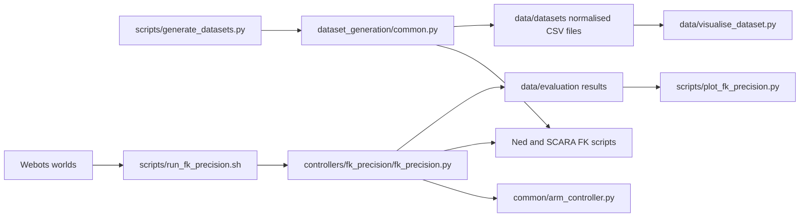

# Intelligent Robotics Coursework 1

## Structure

```text
IR-coursework1/
├── worlds/
│   ├── articulated.wbt                 # Ned simulation
│   └── scara.wbt                       # SCARA simulation
├── protos/TeachingNed.proto            # Ned model and TCP slot
├── controllers/
│   ├── common/arm_controller.py        # Webots motor and TCP control
│   └── fk_precision/fk_precision.py    # Task 1.C simulator validation
├── scripts/
│   ├── forward_kinematics_ned.py       # Task 1.B Ned FK
│   ├── forward_kinematics_scara.py     # Task 1.B SCARA FK
│   ├── dataset_generation/common.py    # Shared Task 2 generation core
│   ├── generate_datasets.py            # Task 2 Ned/SCARA entry point
│   ├── run_fk_precision.sh             # Runs Task 1.C for both robots
│   └── plot_fk_precision.py            # Summarises Task 1.C results
└── data/
    ├── datasets/                       # Task 2 train/validation/test files
    ├── evaluation/                     # Task 1.C results
    ├── visualise_dataset.py            # Shared visualisation entry point
    └── visualisation/common.py         # CSV and robot drawing helpers
```

### How the files connect



Task 1.C validates each FK implementation against Webots. Once validated, Task
2 calls FK directly, avoiding a slow physical simulation move for every training
row. This keeps simulator evaluation separate from generated training data.

## Dataset generation

Generate all Ned and SCARA datasets without starting Webots:

```bash
python3 scripts/generate_datasets.py both
```

Defaults are 1,000, 5,000 and 10,000 total samples before each 80/20 split,
plus a separate 500-row test set. The sets are nested: small is contained in
medium, and medium in large. Use `--sizes`, `--test-size` and `--seed` to change
these settings. Output is written under `data/datasets/ned/` and
`data/datasets/scara/`.

The shared core keeps sampling, splitting and CSV behaviour identical. The main
script supplies each robot's limits, FK and floor clearance. Elbow-up sampling
makes the position-to-joint mapping single-valued. Joint outputs are normalised
to `[-1, 1]`; SCARA `q3` represents its third active output,
`shaft_linear_motor` (physical q4).

### Dataset acceptance and rejection

| Rule | Result | Justification |
|---|---|---|
| Ned `joint_3` or SCARA `arm_motor` would be negative | Never sampled | The positive range keeps only the required elbow-up solution. |
| Ned FK gives `z < 0.14 m` | Resample | Avoids known Ned wrist/gripper contact with the floor. |
| SCARA FK gives `z < 0.02 m` | Resample | Avoids known SCARA shaft contact with the floor. |
| TCP position duplicates an existing row | Resample | Keeps train, validation and test positions distinct. |
| All checks pass | Save the row | Store normalised joints with the FK-derived TCP position. |

The height rules prevent known floor contact; they are not a general
self-collision detector. Simulator settling and FK/TCP error are evaluated in
Task 1.C rather than repeated for every Task 2 row.

## Dataset visualisation

The shared visualiser supports both current normalised datasets and older raw
FK/Webots comparison CSVs:

```bash
python3 data/visualise_dataset.py ned data/datasets/ned/train_small.csv
python3 data/visualise_dataset.py scara data/datasets/scara/train_small.csv
```

It displays the TCP distribution, a selected robot pose and either normalised
joint distributions or the available FK/Webots error histogram. Use `--row` to
select a pose, `--tcp-source expected` for a raw comparison file, or
`--save figure.png` to save the figure.
