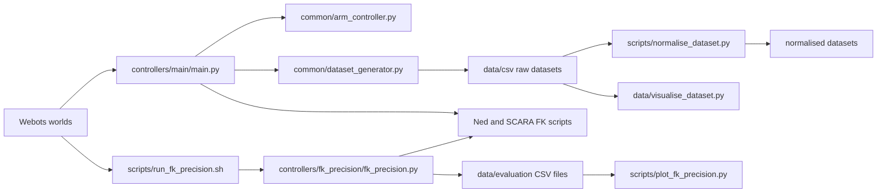

See the wiki for a basic tutorial.

## Structure

```text
IR-coursework1/
├── worlds/
│   ├── articulated.wbt              # Ned simulation
│   └── scara.wbt                    # SCARA simulation
├── protos/
│   └── TeachingNed.proto            # Ned model and TCP slot
├── controllers/
│   ├── main/main.py                 # Ned/SCARA dataset entry point
│   ├── common/
│   │   ├── arm_controller.py        # Motor movement and TCP measurement
│   │   └── dataset_generator.py     # Shared sampling, filtering and CSV output
│   └── fk_precision/fk_precision.py # Task 1.C simulator validation
├── scripts/
│   ├── forward_kinematics_ned.py    # Task 1.B Ned FK
│   ├── forward_kinematics_scara.py  # Task 1.B SCARA FK
│   ├── normalise_dataset.py         # Task 2 joint normalisation
│   ├── run_fk_precision.sh          # Runs Task 1.C for both robots
│   └── plot_fk_precision.py         # Summarises Task 1.C results
└── data/
    ├── csv/                         # Raw and processed datasets
    ├── evaluation/                  # Task 1.C measurements and summary
    ├── visualise_dataset.py         # Ned/SCARA visualisation entry point
    └── visualisation/common.py      # Shared CSV and drawing helpers
```

### How the files connect



The worlds select `main.py` with either `ned` or `scara`. The main controller
supplies the robot-specific joints and FK function to the shared generator. Raw
CSV files can then be normalised for training or inspected with the shared
visualiser. Task 1.C uses the same FK implementations through a separate
evaluation controller so validation data stays independent of training data.

## Dataset generation

The shared generation logic is in `controllers/common/dataset_generator.py`.
Both robots use `controllers/main/main.py`; their world files pass either
`ned` or `scara` as the first controller argument. Starting either world
continuously generates random elbow-up samples under `data/csv/`.

This separation keeps sampling and CSV behaviour identical while leaving motor
names, limits, FK and fixed joints in one small robot configuration. Elbow-up
sampling makes the position-to-joint mapping single-valued for model training.

The main controller accepts optional Webots arguments. For example,
`scara --samples 1000 --seed 42` generates exactly 1,000 valid, reproducible
SCARA rows and then closes the simulation. Edit `POSES` in `main.py` to check
fixed poses.

All generated files use the generic columns `joint1`, `joint2`, and `joint3` so
both robots can train one network. For SCARA, `joint3` is the third active model
output, `shaft_linear_motor` (physical q4). Values remain raw here so the FK and
Webots measurements are auditable; normalisation is a separate processing step.

Before commanding Webots, the generator rejects poses whose FK endpoint is
below the floor-clearance threshold: 0.14 m for Ned and 0.02 m for SCARA.
These limits avoid known floor contacts. It also rejects poses that fail to
settle or exceed 1 mm FK/TCP error, preventing obstructed or inaccurate rows
from entering the dataset. A fixed seed makes comparisons reproducible.

## Dataset visualisation

`data/visualise_dataset.py` uses the shared geometry and CSV helpers in
`data/visualisation/common.py` for both robots. It displays the TCP distribution,
one robot pose, and the FK/Webots error histogram. Sharing the plots makes the
robots directly comparable while retaining their different geometry. For example:

```bash
python3 data/visualise_dataset.py ned data/csv/ned_robot_data_1e-3.csv
python3 data/visualise_dataset.py scara data/csv/scara_robot_data_1e-3.csv
```

Use `--row` to select the pose, `--tcp-source expected` to plot FK positions,
or `--save figure.png` to save without opening an interactive window.
