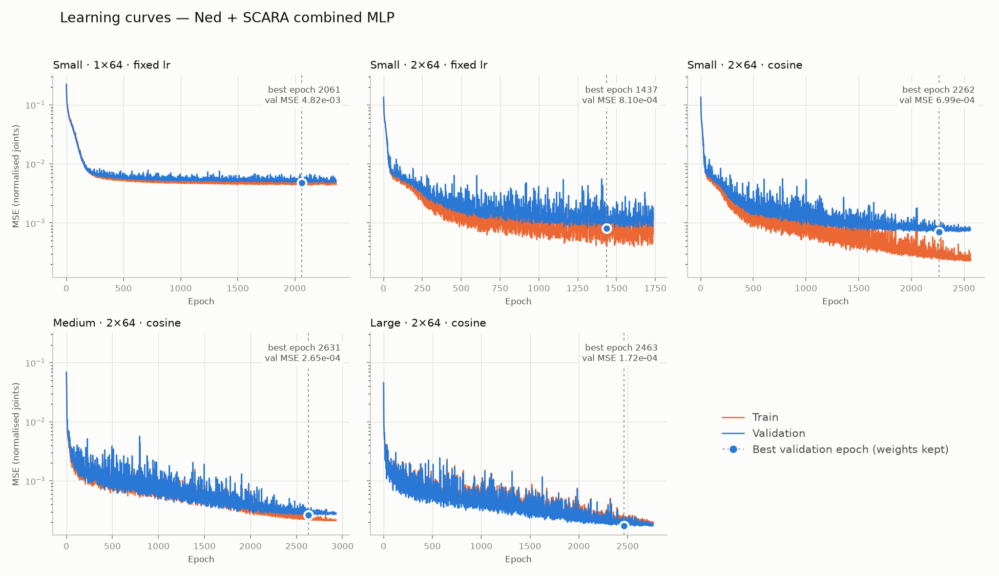
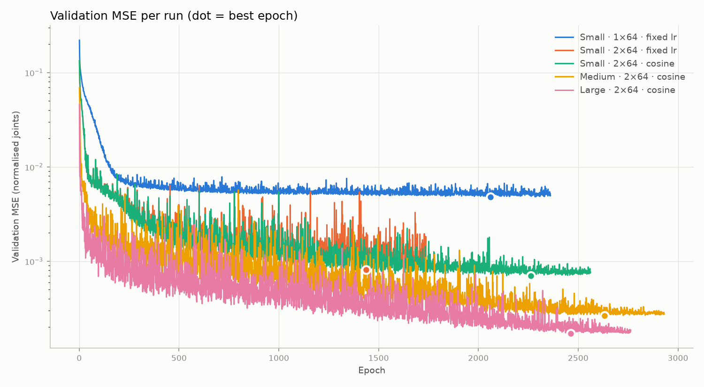

# Validation results — Ned + SCARA combined MLP

ReLU hidden layers, linear output, Adam (lr 1e-3, batch 32), MSE loss, early stopping (patience 300) keeping the best-validation weights. Position error = Euclidean distance between FK(de-normalised prediction) and the target (x, y, z).

| Run | Train rows | Val rows | Best epoch | Epochs run | Train MSE @ best | Val MSE (best) | Ned error (mm) | SCARA error (mm) | Ned max (mm) | SCARA max (mm) |
|---|---:|---:|---:|---:|---:|---:|---:|---:|---:|---:|
| Small · 1×64 · fixed lr | 1600 | 400 | 2061 | 2361 | 4.39e-03 | 4.82e-03 | 16.68 ± 13.87 | 5.89 ± 4.24 | 114.0 | 25.8 |
| Small · 2×64 · fixed lr | 1600 | 400 | 1437 | 1737 | 3.98e-04 | 8.10e-04 | 9.98 ± 8.81 | 2.00 ± 1.49 | 62.5 | 10.4 |
| Small · 2×64 · cosine | 1600 | 400 | 2262 | 2562 | 2.46e-04 | 6.99e-04 | 8.72 ± 8.44 | 1.98 ± 1.52 | 67.4 | 8.9 |
| Medium · 2×64 · cosine | 8000 | 2000 | 2631 | 2931 | 2.25e-04 | 2.65e-04 | 3.64 ± 2.66 | 1.12 ± 0.83 | 21.9 | 6.5 |
| Large · 2×64 · cosine | 24000 | 6000 | 2463 | 2763 | 2.00e-04 | 1.72e-04 | 2.72 ± 1.97 | 0.79 ± 0.67 | 17.3 | 7.5 |

