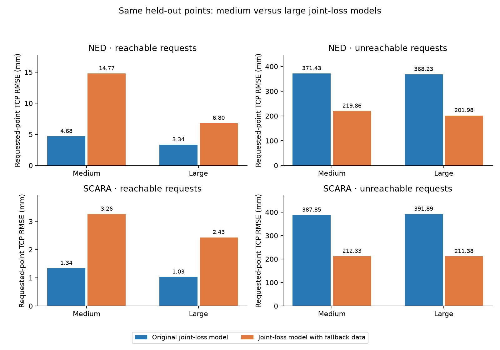
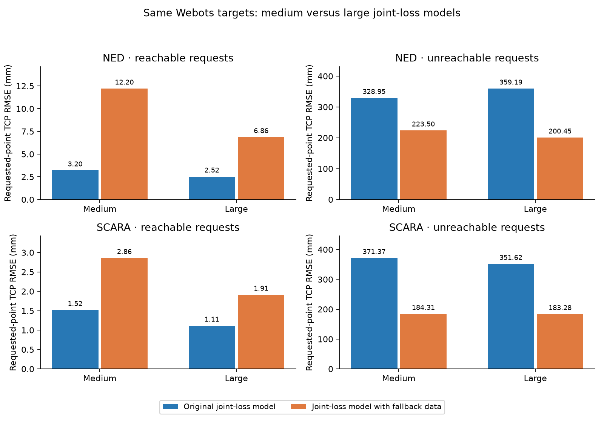

# Dataset-size comparison on identical requested points

Every model is evaluated on exactly the same 1,000 reachable and 1,000 unreachable requested points per arm. Each size retains its original reachable split and adds half as many synthetic training examples (medium: 4,000 + 2,000; large: 12,000 + 6,000). Both use the same architecture, joint loss and training settings. Fallback labels use only each size's own training pose bank, so bank density and training quantity both change.

The table compares the two models trained with fallback examples; the graph also includes the original checkpoints.

| Arm | Requests | Medium with fallback RMSE (mm) | Large with fallback RMSE (mm) | Lower RMSE |
|---|---|---:|---:|---|
| ned | reachable | 14.77 | 6.80 | Large |
| ned | unreachable | 219.86 | 201.98 | Large |
| scara | reachable | 3.26 | 2.43 | Large |
| scara | unreachable | 212.33 | 211.38 | Large |

Webots comparison uses identical first 10 reachable and 20 unreachable test requests per arm/model. Full measurements and settling status are retained in each experiment's report folder.

The endpoint reference here is requested XYZ, including unreachable points. Fallback endpoints differ between the finite medium and large pose banks, so error to those different fallback labels is not used to rank sizes.
