# Task 4.A results: MLP configurations

35 trained configurations, each evaluated on the full independent test set of
both arms (1,000 points each) with the Task 4.A procedure. The procedure, metrics
and output files are described in the main `README.md`. To regenerate everything:

```bash
python scripts/evaluate_configurations.py
python scripts/plot_configuration_results.py
```

For a ranking by architecture rather than by checkpoint (dataset size
collapsed to whichever size scored best for that design), see
[ranking_by_architecture.md](ranking_by_architecture.md).

## Model selection

One model per dataset size, chosen by the **lowest validation MSE on the
normalised joints** (the training loss, `best_val_mse`). The test sets are only
used after the choice. All three picks are the same network, 64-64-64-64 with
tanh, so the size comparison below changes only the amount of data.

`summary.csv` also lists each model's validation TCP error for reference. It does
not drive the selection. The two measures can disagree: see
[Per-robot activation](#per-robot-activation).

## The 6 position-error sets

| Size | Model | Arm | Mean ± std (mm) | Median | P95 | Max | ≤ 5 mm |
|---|---|---|---|---|---|---|---|
| small | 64-64-64-64 tanh | Ned | 2.29 ± 2.94 | 1.41 | 7.10 | 36.9 | 90.7% |
| small | 64-64-64-64 tanh | SCARA | 1.21 ± 2.92 | 0.81 | 3.04 | 79.5 | 98.4% |
| medium | 64-64-64-64 tanh | Ned | 1.65 ± 2.20 | 1.13 | 4.12 | 31.9 | 96.6% |
| medium | 64-64-64-64 tanh | SCARA | 0.95 ± 1.32 | 0.64 | 2.64 | 29.2 | 99.1% |
| large | 64-64-64-64 tanh | Ned | 1.68 ± 1.67 | 1.26 | 4.22 | 29.4 | 97.2% |
| large | 64-64-64-64 tanh | SCARA | 0.94 ± 1.00 | 0.68 | 2.56 | 12.0 | 98.8% |

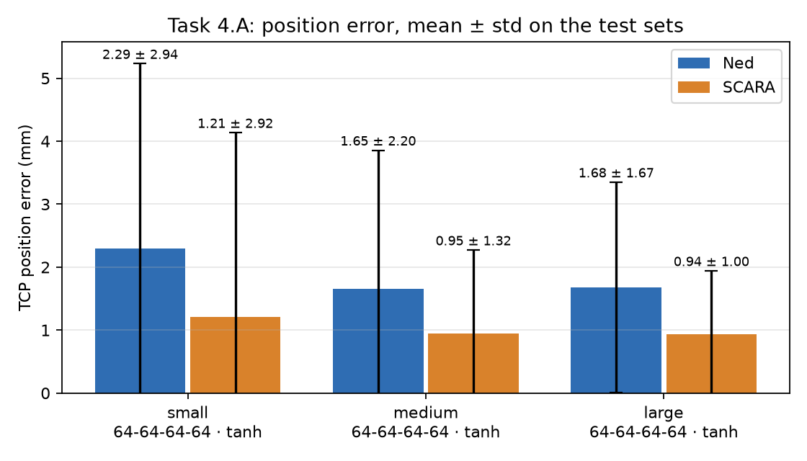

The standard deviation is often larger than the mean because the errors are
skewed: most points are well under the mean, and a few are tens of millimetres
off. The median and P95 describe a typical point better than mean ± std alone.

## The 18 joint-error sets

Revolute joints use the wrapped angular difference (rad). The SCARA shaft uses
the squared difference (m²), as the handout specifies. The means are signed, so
over- and under-shoots cancel. Mean |error| is added to show the size of the errors.

| Size | Arm | Joint | Unit | Mean ± std | Mean \|error\| |
|---|---|---|---|---|---|
| small | Ned | joint_1 | rad | −0.00158 ± 0.0159 | 0.00988 |
| small | Ned | joint_2 | rad | −0.000288 ± 0.00637 | 0.00369 |
| small | Ned | joint_3 | rad | 0.000225 ± 0.00361 | 0.00230 |
| small | SCARA | base_arm_motor | rad | −0.00111 ± 0.00932 | 0.00445 |
| small | SCARA | arm_motor | rad | 0.00200 ± 0.0156 | 0.00763 |
| small | SCARA | shaft_linear_motor | m² | 2.04e−7 ± 7.07e−7 | 2.04e−7 |
| medium | Ned | joint_1 | rad | 0.00427 ± 0.0958 | 0.0112 |
| medium | Ned | joint_2 | rad | 0.000685 ± 0.00403 | 0.00257 |
| medium | Ned | joint_3 | rad | 0.000325 ± 0.00210 | 0.00152 |
| medium | SCARA | base_arm_motor | rad | −0.000262 ± 0.00450 | 0.00263 |
| medium | SCARA | arm_motor | rad | 0.000233 ± 0.00936 | 0.00397 |
| medium | SCARA | shaft_linear_motor | m² | 4.83e−8 ± 3.46e−7 | 4.83e−8 |
| large | Ned | joint_1 | rad | 0.00306 ± 0.0561 | 0.00916 |
| large | Ned | joint_2 | rad | −0.00138 ± 0.00357 | 0.00267 |
| large | Ned | joint_3 | rad | −0.0000635 ± 0.00196 | 0.00149 |
| large | SCARA | base_arm_motor | rad | 0.000593 ± 0.00439 | 0.00252 |
| large | SCARA | arm_motor | rad | −0.000180 ± 0.00843 | 0.00333 |
| large | SCARA | shaft_linear_motor | m² | 4.20e−8 ± 8.01e−8 | 4.20e−8 |

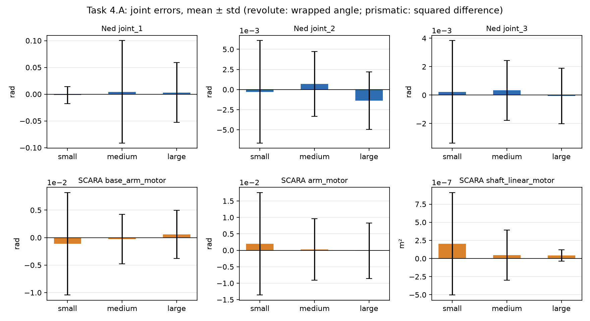

All signed means are close to zero, so no model has a systematic bias. Ned's
base joint (joint_1) has by far the widest spread. A likely explanation is that
targets close to the vertical base axis barely depend on the base angle, so a
large base-angle error there moves the TCP very little. We have not verified
this against target positions.

## Task 4.B: Webots on the first 100 test points

The three Task 4.A models were run in headless Webots on the first 100 rows of
each arm's test set (`test_sets/`). The controller commands the predicted joints,
waits until every joint stays within 0.001 of its command for 0.25 simulated
seconds, and the Supervisor reads the TCP. All 600 targets settled.

| Size | Arm | 4.B Webots, first 100 (mm) | FK on the same 100 (mm) | 4.A FK, full test (mm) | Mean FK–Webots gap (mm) |
|---|---|---|---|---|---|
| small | Ned | 2.31 ± 2.69 | 2.32 ± 2.68 | 2.29 ± 2.94 | 0.125 |
| small | SCARA | 1.54 ± 3.50 | 1.54 ± 3.50 | 1.21 ± 2.92 | 0.124 |
| medium | Ned | 1.39 ± 1.16 | 1.38 ± 1.15 | 1.65 ± 2.20 | 0.125 |
| medium | SCARA | 1.30 ± 3.00 | 1.28 ± 3.01 | 0.95 ± 1.32 | 0.124 |
| large | Ned | 1.58 ± 1.06 | 1.56 ± 1.08 | 1.68 ± 1.67 | 0.125 |
| large | SCARA | 1.03 ± 1.35 | 1.00 ± 1.35 | 0.94 ± 1.00 | 0.124 |

Full numbers, including median, P95 and max, are in `task4b_position.csv`, and
every measured point is in `task4b_measurements.csv`.

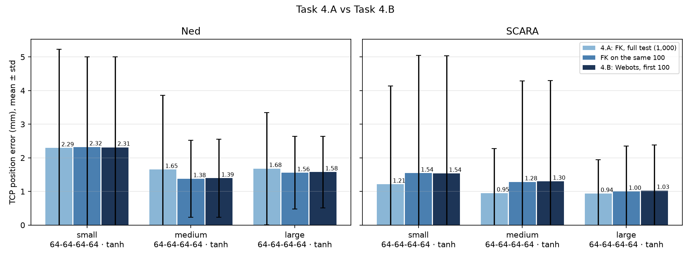

**Webots confirms the FK evaluation.** On the same 100 points, the Webots error
and the FK error differ by at most 0.03 mm. The TCP that Webots measures is on
average 0.12 mm from the FK prediction (at most 0.27 mm), which is small next to
the network's own error of 1 to 2 mm.

**The gaps between 4.A and 4.B come from the test points, not the simulator.**
4.B uses 100 points and 4.A uses 1,000, so a single hard point weighs ten times
more in 4.B. For example, the medium model's SCARA mean rises from 0.95 mm (4.A)
to 1.30 mm (4.B) because one of the first 100 points has a 29.2 mm error. The FK
error on those same 100 points rises by the same amount, so the simulator is not
the cause.

**Possible sources of the remaining 0.12 mm gap:** the settling tolerance (joints
stop within 0.001 of the command, not exactly on it), small differences between
the FK model and the Webots robot geometry (see Task 1.C), and gravity and joint
dynamics in the simulation.

## Findings

**More data helps.** For the selected network, the mean error drops from small
to medium on both arms. From medium to large the mean barely changes, but the
spread narrows and the worst cases improve (Ned max 31.9 → 29.4 mm, SCARA max
29.2 → 12.0 mm).

**The same holds for every architecture except one.** The architecture × size grid
below shows the mean of both arms' errors. The exception, 64-64-64 on the large
set, stopped early at epoch 560: its validation score plateaued for 300 epochs
while the learning rate was still high, before the cosine decay reached the
low-learning-rate phase where the other runs improve. That is a training
artefact, not a property of the architecture.

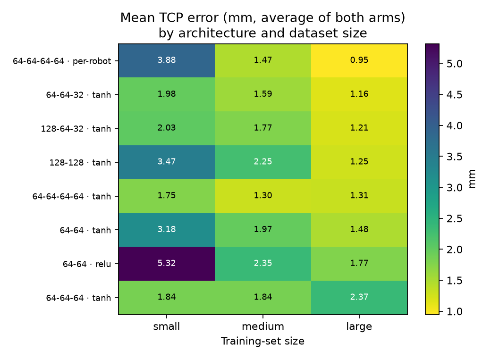

**tanh beats ReLU.** In the 5 pairs that differ only in activation, tanh has the
lower error on Ned every time (often by a lot: small 64-64-64 goes from 6.09 to
2.52 mm). On SCARA, tanh wins 3 of 5, and the differences are small.

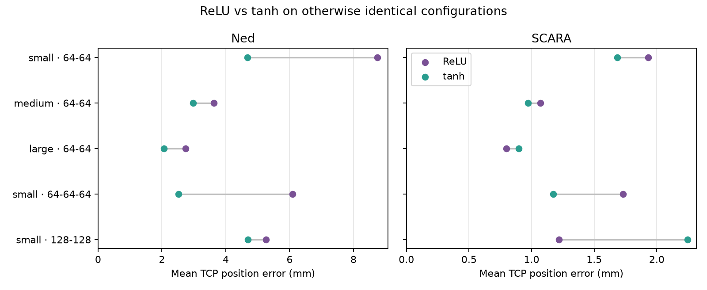

**Depth beats width.** On the small set, four 64-unit tanh layers (1.75 mm)
beat 64-64 (3.18 mm), 128-128 (3.47 mm) and much wider networks such as
1024-1024 (medium set, 4.15 mm). Five layers is slightly worse than four.

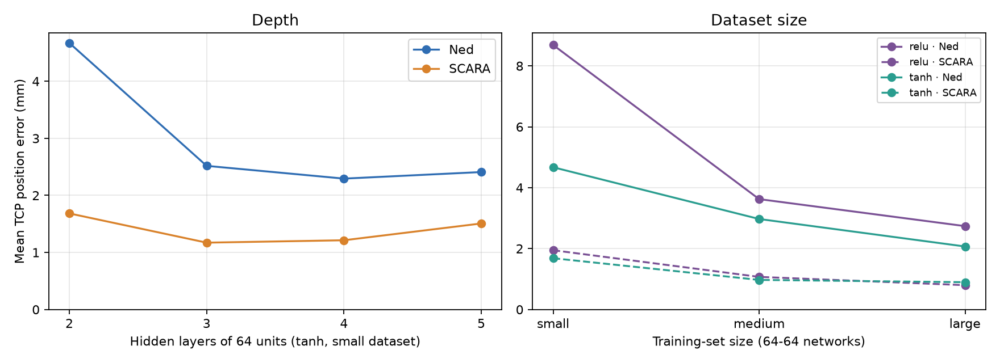
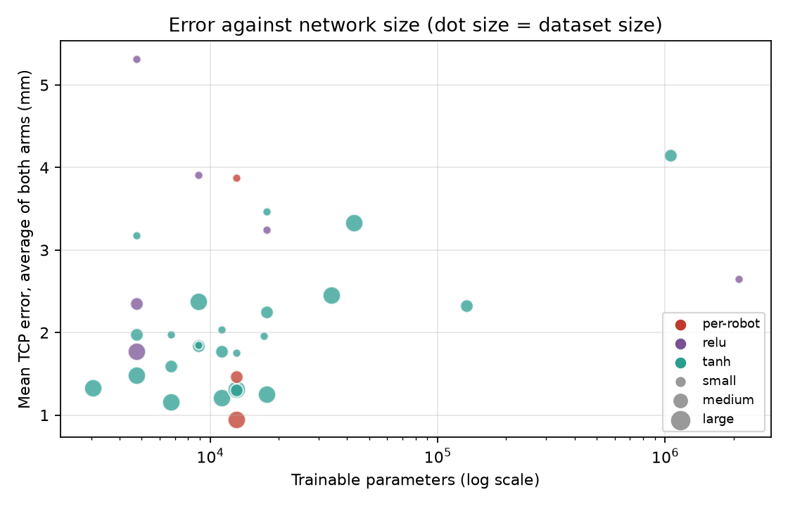

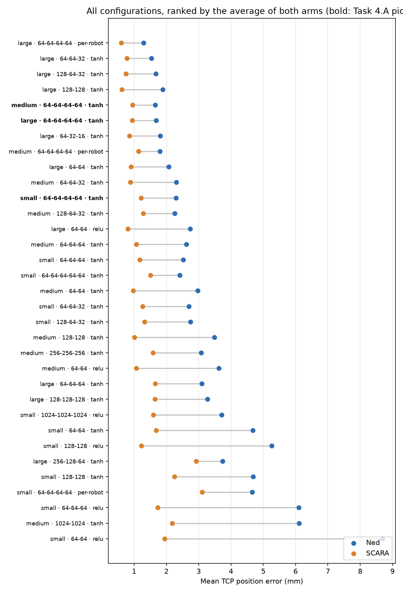
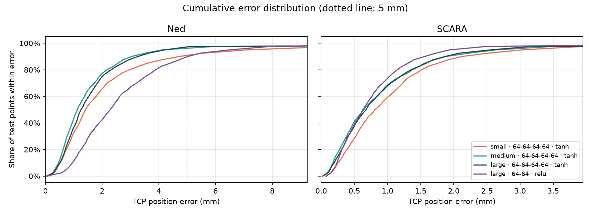
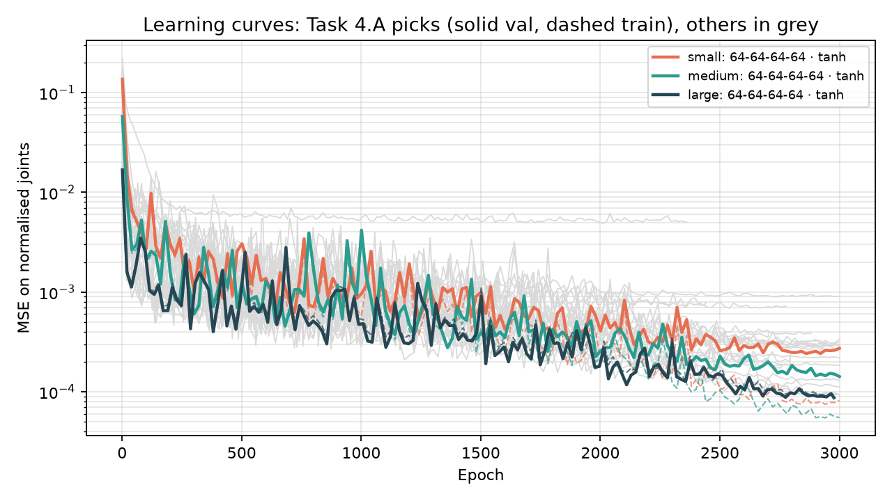

## Per-robot activation

The selected network was also trained with a per-robot activation: tanh for Ned
rows and ReLU for SCARA rows, chosen by the arm flag already in the input. It is
still a single network with shared weights, as Task 3 requires.

| Size | Activation | Val joint MSE | Val TCP (mm) | Test Ned (mm) | Test SCARA (mm) | Stopped at epoch |
|---|---|---|---|---|---|---|
| small | tanh | **0.000236** | **1.79** | **2.29 ± 2.94** | **1.21 ± 2.92** | 3,000 |
| small | per-robot | 0.000755 | 3.89 | 4.65 ± 5.87 | 3.10 ± 2.60 | 993 (early stop) |
| medium | tanh | **0.000137** | **1.33** | **1.65 ± 2.20** | **0.95 ± 1.32** | 3,000 |
| medium | per-robot | 0.000246 | 1.47 | 1.80 ± 1.75 | 1.13 ± 0.89 | 2,258 (early stop) |
| large | tanh | **0.000082** | 1.32 | 1.68 ± 1.67 | 0.94 ± 1.00 | 2,977 (early stop) |
| large | per-robot | 0.000093 | **0.92** | **1.29 ± 1.69** | **0.60 ± 0.64** | 3,000 |

Bold marks the better of each pair.

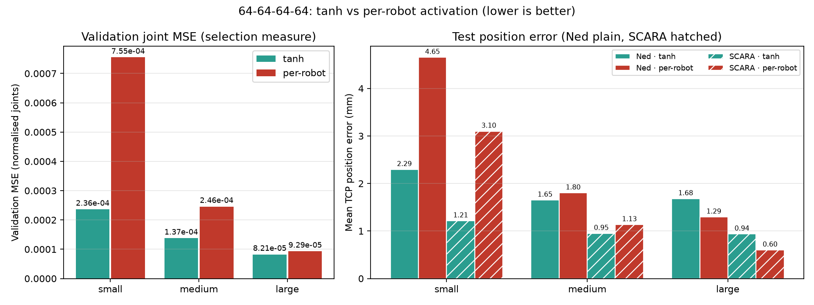

- **Small and medium:** plain tanh is better on every measure. On the small set
  the per-robot run overfitted: training MSE kept falling (0.00049 at epoch 900)
  while validation MSE stayed near 0.0012. It then stopped at epoch 993, while the
  learning rate was still high.
- **Large:** per-robot has the lowest test position error of all 35 models on both
  arms, but a slightly higher validation joint MSE. Under joint-MSE selection,
  plain tanh is the Task 4.A pick.
- **Overall:** per-robot only pays off with enough data. Since the result depends
  on dataset size and on early stopping, it is reported as a tested variant
  rather than the main model.

## Limits

- Every configuration was trained once, with seed 2026. Differences of a few
  tenths of a millimetre between models may be within seed-to-seed variation.
- The per-robot activation was tested on one architecture only. Two of its three
  runs stopped early, so a rerun without early stopping would make the comparison
  with tanh fairer.
- The grid is still incomplete. For example, 64-32-16 and 128-128-128 exist only
  on the large set.
