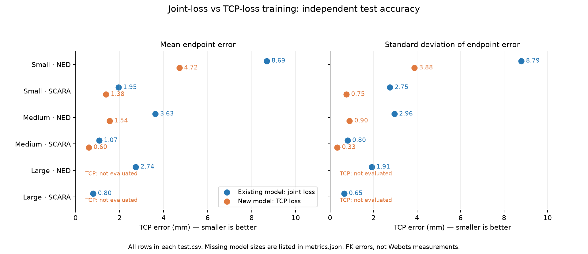

# Coursework evaluation verification

Task 4.A and Task 4.B were run on all six saved checkpoints, using the unchanged independent test files and model weights identified in the JSON hashes.

- Task 4.A: 12,000 predictions; 12 position-error summaries and 36 physical per-joint summaries.
- Task 4.B: 1,200 actual Supervisor TCP measurements; first 100 test samples per arm for each checkpoint; all 1,200 settled, with no timeouts.
- Joint-loss family: all three sizes and both arms evaluated (six position summaries and eighteen joint summaries in Task 4.A).
- TCP-loss family: all three sizes and both arms evaluated (six position summaries and eighteen joint summaries in Task 4.A).



[Graph gallery for both evaluations](graphs/README.md)

## Task 4.B measured position errors

| Size | Objective | Robot | Mean ± std (mm) | Settled |
|---|---|---|---:|---:|
| small | existing_joints | ned | 9.284 ± 11.029 | 100/100 |
| small | existing_joints | scara | 1.760 ± 1.372 | 100/100 |
| small | tcp | ned | 5.114 ± 4.924 | 100/100 |
| small | tcp | scara | 1.419 ± 0.862 | 100/100 |
| medium | existing_joints | ned | 3.750 ± 2.722 | 100/100 |
| medium | existing_joints | scara | 1.076 ± 0.797 | 100/100 |
| medium | tcp | ned | 1.372 ± 0.670 | 100/100 |
| medium | tcp | scara | 0.629 ± 0.319 | 100/100 |
| large | existing_joints | ned | 2.827 ± 2.160 | 100/100 |
| large | existing_joints | scara | 0.819 ± 0.462 | 100/100 |
| large | tcp | ned | 1.188 ± 0.490 | 100/100 |
| large | tcp | scara | 0.380 ± 0.174 | 100/100 |

## Saved files

- [Task 4.A position statistics](task4a_summary.csv)
- [Task 4.A physical per-joint statistics](task4a_joint_errors.csv)
- [Task 4.A definitions, hashes and coverage](task4a_metrics.json)
- [Task 4.B position statistics](task4b_summary.csv)
- [Task 4.B run settings, hashes and coverage](task4b_metrics.json)

These files are a verified run snapshot. Complete per-sample predictions and reduced test files are generated in `outputs/task4a/` and `outputs/task4b/`; those runtime folders are ignored by Git. Standard deviations use ddof=0. Angular errors are signed wrapped differences in rad; the SCARA lift statistic is squared displacement error in m², following the handout.

## Run again

```bash
python scripts/evaluate_task4a.py
python scripts/evaluate_task4b.py
```

The second command needs Webots. On Windows use `--webots` if the launcher cannot be found automatically. Both scripts support `--output` for a separate run folder.
