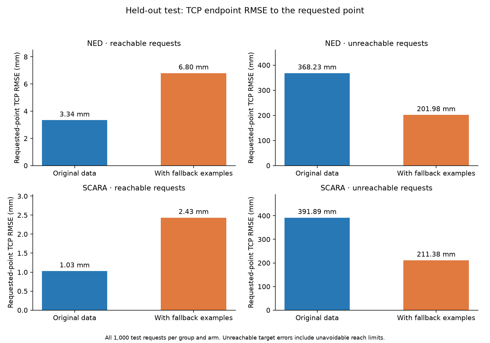
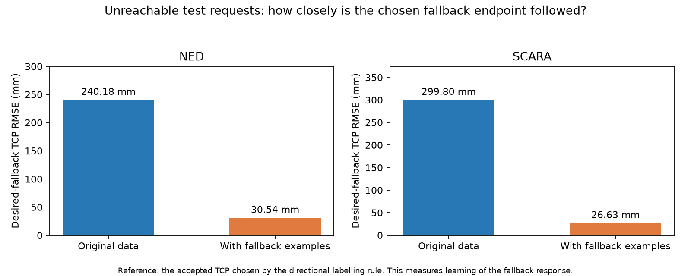
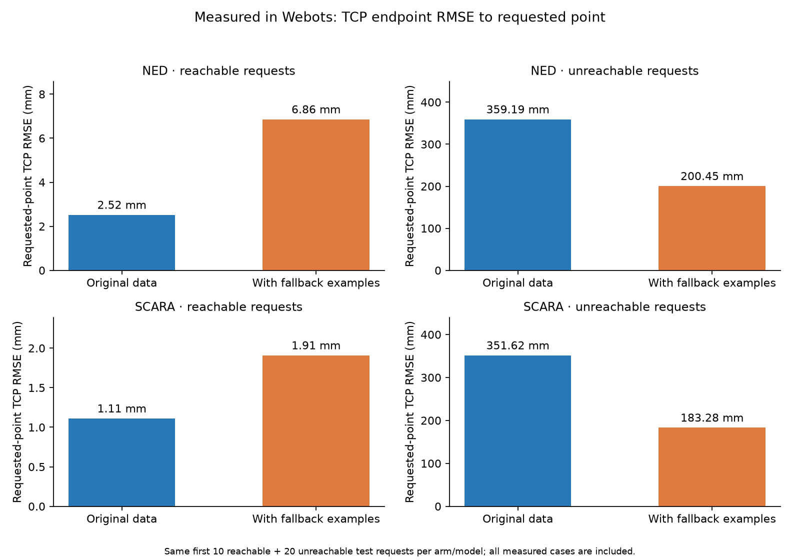
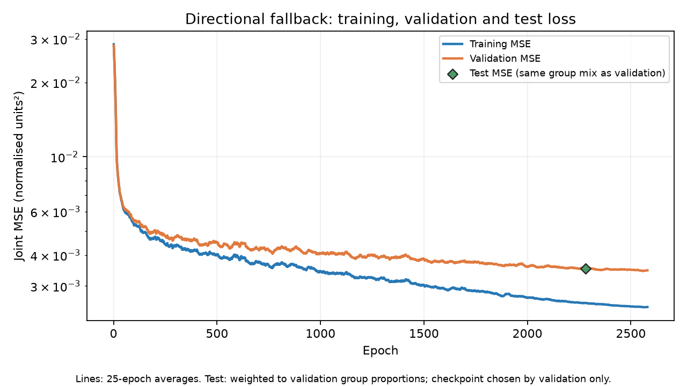

# Joint-loss directional fallback experiment

The new dataset teaches the arm to point toward an unreachable request, then approach it. Ned uses the 3D direction from its shoulder; SCARA uses horizontal bearing because its links cannot tilt upward. Find the best recorded direction; among accepted poses within 2 degrees of that direction error, choose the TCP closest to the request. If SCARA's requested point is exactly on its yaw axis, bearing is undefined and distance alone chooses the label. This selects the best available recorded pose; a finite pose bank does not prove a globally optimal result.

New requests are certified outside the full joint-limited FK workspace using a conservative grid-cover bound or an analytic enclosing volume, with a minimum 5 mm clearance. Half the generated requests are within 100 mm of the accepted pose bank and half farther away. Query displacements span 15–600 mm from bank positions. Every label uses an original training pose with a Webots audit row. The requests are synthetic; no simulated TCP reading is invented at an impossible requested location.

Original reachable rows retain their labels. New query splits have independent seeds, and validation/test poses never supply training labels. This tests new requests against a fixed training reference bank. Accepted static poses do not guarantee collision-free motion, and the MLP can predict an unrecorded configuration. Its response beyond the sampled query distribution is unverified.

Training reuses the 5→64→64→3 NumPy ReLU MLP, Adam and joint MSE, from scratch with seed 2026 and up to 3000 epochs. Validation joint MSE selected epoch 2280; training ended at epoch 2580. Best validation joint MSE: 0.00338556. Test data were evaluated afterward. This comparison changes data quantity and distribution together.

Split counts per arm: {"train_large": {"reachable": 12000, "unreachable": 6000}, "validation_large": {"reachable": 3000, "unreachable": 1500}, "test": {"reachable": 1000, "unreachable": 1000}}

## Requested-point endpoint error

For each sample, e = Euclidean distance from final TCP to requested XYZ, in mm. MSE = mean(e²), in mm²; RMSE = sqrt(mean(e²)), in mm. Mean/std are statistics of e, using population std. Unreachable requests include an unavoidable geometric gap, so their RMSE cannot be interpreted as ordinary reachable IK accuracy.

| Arm | Group | Training data | MSE (mm²) | RMSE (mm) | Mean (mm) | Std (mm) |
|---|---|---|---:|---:|---:|---:|
| ned | reachable | Original | 11.16 | 3.34 | 2.74 | 1.91 |
| ned | unreachable | Original | 135596.71 | 368.23 | 294.24 | 221.40 |
| ned | reachable | With fallback examples | 46.28 | 6.80 | 5.84 | 3.50 |
| ned | unreachable | With fallback examples | 40795.51 | 201.98 | 166.15 | 114.84 |
| scara | reachable | Original | 1.06 | 1.03 | 0.80 | 0.65 |
| scara | unreachable | Original | 153578.16 | 391.89 | 313.26 | 235.47 |
| scara | reachable | With fallback examples | 5.92 | 2.43 | 2.09 | 1.25 |
| scara | unreachable | With fallback examples | 44679.67 | 211.38 | 157.55 | 140.92 |

## Error to the chosen fallback endpoint

For unreachable inputs, this measures final TCP distance to the accepted fallback TCP used to create the joint label. It measures how accurately the new response was learned. The requested-point error above remains the main endpoint comparison.

| Arm | Training data | Fallback RMSE (mm) | Mean (mm) | Std (mm) | P95 (mm) | Maximum (mm) |
|---|---|---:|---:|---:|---:|---:|
| ned | Original | 240.18 | 196.78 | 137.71 | 443.98 | 622.67 |
| ned | With fallback examples | 30.54 | 21.19 | 21.99 | 43.42 | 383.18 |
| scara | Original | 299.80 | 221.77 | 201.74 | 642.78 | 859.99 |
| scara | With fallback examples | 26.63 | 9.81 | 24.76 | 21.60 | 751.25 |

Individual failures remain. A joint-MSE regressor can average distinct joint solutions where the selected label switches branch, particularly near Ned's rear yaw limits. `failure_examples.csv` records the worst fallback endpoint error for each arm. `test_predictions.csv` retains all requested/desired/predicted points, normalised labels, raw outputs and physical joint commands. Direction determines the labelling rule; evaluation uses TCP endpoint errors.

## Measured in Webots

The first 10 reachable and 20 unreachable test requests per arm were executed for each saved model. Settling required joint sensors to remain within tolerance for 0.25 simulated seconds, with a 10-second timeout. Every result is included, including any timeouts.

| Arm | Group | Training data | Samples | Settled | Requested TCP RMSE (mm) | Fallback TCP RMSE (mm) |
|---|---|---|---:|---:|---:|---:|
| ned | reachable | Original | 10 | 10 | 2.52 | 2.52 |
| ned | reachable | With fallback examples | 10 | 10 | 6.86 | 6.86 |
| ned | unreachable | Original | 20 | 20 | 359.19 | 243.07 |
| ned | unreachable | With fallback examples | 20 | 20 | 200.45 | 57.35 |
| scara | reachable | Original | 10 | 10 | 1.11 | 1.11 |
| scara | reachable | With fallback examples | 10 | 10 | 1.91 | 1.91 |
| scara | unreachable | Original | 20 | 20 | 351.62 | 256.40 |
| scara | unreachable | With fallback examples | 20 | 20 | 183.28 | 10.71 |

## Training loss

The test marker is reweighted to validation group proportions (2 reachable to 1 unreachable in this run); the test files have an equal group mix. Per-group endpoint metrics above are unweighted. Curves are 25-epoch moving averages.

## Run and use

Run `python scripts/run_fallback_training.py --name directional_fallback_repeat` from the repository root; add `--webots PATH` for physics measurements. Existing paths/checkpoints are refused. Data: `data/nn/directional_fallback`; policy audit: `data/raw/directional_fallback`. `manifest.json` records dataset hashes and `source_integrity.json` confirms original data and checkpoint hashes.

In Webots keep controller `mlp_ik` and append `"--model=mlp_ned_scara_large_h64x64_cosine_directional_fallback"` after `"ned"` or `"scara"` in `controllerArgs`. The network supplies the learned fallback response.
