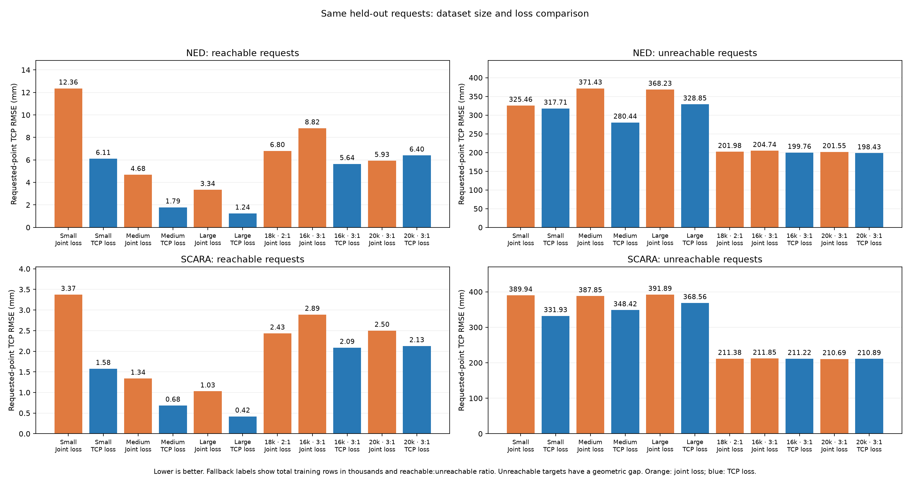

# 16,000-row fallback models (3:1 reachable to unreachable)

Each arm has 12,000 reachable and 4,000 certified-unreachable training rows, plus 3,000 + 1,000 validation rows. Both models use seed 2026, the same 5→64→64→3 architecture and training settings as the 20,000-row experiment. The joint-loss checkpoint selected epoch 652 (stopped at 952); the TCP-loss checkpoint selected epoch 520 (stopped at 820). Validation selected each checkpoint; test data did not.

## Requested-point TCP RMSE on the shared held-out requests

The comparison uses the same 1,000 reachable and 1,000 unreachable test requests per arm as the 20,000-row models. Lower is better. Unreachable RMSE includes the geometric gap from the impossible request.

| Arm | Loss | Reachable (mm) | Unreachable (mm) |
|---|---|---:|---:|
| Ned | Joint | 8.82 | 204.74 |
| Ned | TCP | 5.64 | 199.76 |
| SCARA | Joint | 2.89 | 211.85 |
| SCARA | TCP | 2.09 | 211.22 |

The 20,000-row results were Ned 5.93/201.55 mm (joint) and 6.40/198.43 mm (TCP); SCARA 2.50/210.69 mm (joint) and 2.13/210.89 mm (TCP), reachable/unreachable. The two dataset sizes use different reachable pose banks as well as different row counts, so the difference cannot be attributed to size alone. These are FK-based test evaluations; the 16k models have not been measured in Webots.



Training data and audit are in `data/nn/directional_fallback_total_16000/` and `data/raw/directional_fallback_total_16000/`. Checkpoints are:

- `mlp_ned_scara_total16000_3to1_joints`
- `mlp_ned_scara_total16000_3to1_tcp`

To reproduce the checkpoint comparison on these saved models and the 20k test set, run:

```bash
python scripts/run_fallback_training.py --name directional_fallback_total_20000 --evaluate-models mlp_ned_scara_total16000_3to1_joints mlp_ned_scara_total16000_3to1_tcp mlp_ned_scara_total20000_3to1_joints mlp_ned_scara_total20000_3to1_tcp
```
