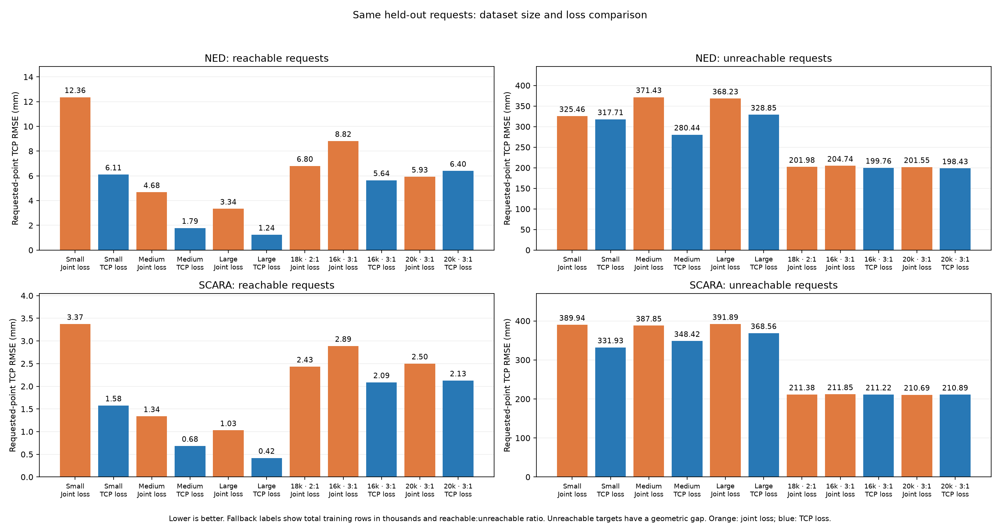
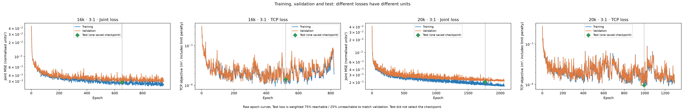

# Fallback dataset-size and loss comparison on shared test requests

All models below are evaluated on the exact same held-out points: 1,000 reachable and 1,000 unreachable requests per robot. The original small, medium and large checkpoints were trained on reachable data only. The original large checkpoint used 12,000 training rows from the 16,000-row generated dataset. The new 16k-total models use 12,000 reachable + 4,000 unreachable training rows; the 20k-total models use 15,000 + 5,000. Both use a 3:1 ratio. The earlier 2:1 model uses 12,000 + 6,000 rows. Requested-point TCP RMSE is compared, independent of each experiment's fallback labels.

The 16k and 20k training sets use different reachable pose banks as well as different row counts, so their comparison does not isolate dataset size alone. Small and medium models provide reachable-only baselines. Loss curves for both new total-dataset sizes are included below. Existing Webots measurements in this folder cover the five earlier large models; the newly trained 16k models have not been measured in Webots.

## 3:1 training details

For the 20k experiment: training per robot is 15,000 reachable + 5,000 certified unreachable requests (3:1); validation is 3,750 + 1,250. Test: 1,000 + 1,000. The 16k experiment uses 12,000 + 4,000 training and 3,000 + 1,000 validation rows. Both use the same 5→64→64→3 ReLU architecture, seed 2026, Adam, batch 32, cosine learning-rate schedule, 3,000-epoch maximum and patience 300. Best checkpoints are chosen by validation only.

Joint loss learns the normalised joint label. TCP loss learns the corresponding desired endpoint through the robot-specific differentiable FK, plus the existing joint-limit penalty. For unreachable requests the desired endpoint is the accepted fallback pose, while the network input remains the requested point. The original TCP datasets have no fallback targets and retain their original requested-point objective.

The held-out inputs are identical across models. Earlier datasets differ in both row count and reachable-pose-bank size, so the 3:1 versus 2:1 comparison does not isolate ratio alone.



| Robot | Requests | Training / loss | Requested TCP RMSE (mm) | Mean error (mm) | Chosen target TCP RMSE (mm) |
|---|---|---|---:|---:|---:|
| ned | reachable | Small / Joint loss | 12.36 | 8.69 | 12.36 |
| ned | unreachable | Small / Joint loss | 325.46 | 263.94 | 209.13 |
| ned | reachable | Small / TCP loss | 6.11 | 4.72 | 6.11 |
| ned | unreachable | Small / TCP loss | 317.71 | 249.54 | 198.31 |
| ned | reachable | Medium / Joint loss | 4.68 | 3.63 | 4.68 |
| ned | unreachable | Medium / Joint loss | 371.43 | 300.61 | 249.17 |
| ned | reachable | Medium / TCP loss | 1.79 | 1.54 | 1.79 |
| ned | unreachable | Medium / TCP loss | 280.44 | 219.42 | 167.39 |
| ned | reachable | Large / Joint loss | 3.34 | 2.74 | 3.34 |
| ned | unreachable | Large / Joint loss | 368.23 | 294.24 | 240.49 |
| ned | reachable | Large / TCP loss | 1.24 | 1.11 | 1.24 |
| ned | unreachable | Large / TCP loss | 328.85 | 258.97 | 213.97 |
| ned | reachable | 18k · 2:1 / Joint loss | 6.80 | 5.84 | 6.80 |
| ned | unreachable | 18k · 2:1 / Joint loss | 201.98 | 166.15 | 29.59 |
| ned | reachable | 16k · 3:1 / Joint loss | 8.82 | 7.31 | 8.82 |
| ned | unreachable | 16k · 3:1 / Joint loss | 204.74 | 167.92 | 40.06 |
| ned | reachable | 16k · 3:1 / TCP loss | 5.64 | 5.08 | 5.64 |
| ned | unreachable | 16k · 3:1 / TCP loss | 199.76 | 163.56 | 29.41 |
| ned | reachable | 20k · 3:1 / Joint loss | 5.93 | 4.98 | 5.93 |
| ned | unreachable | 20k · 3:1 / Joint loss | 201.55 | 165.47 | 32.29 |
| ned | reachable | 20k · 3:1 / TCP loss | 6.40 | 5.85 | 6.40 |
| ned | unreachable | 20k · 3:1 / TCP loss | 198.43 | 162.36 | 22.15 |
| scara | reachable | Small / Joint loss | 3.37 | 1.95 | 3.37 |
| scara | unreachable | Small / Joint loss | 389.94 | 311.93 | 300.79 |
| scara | reachable | Small / TCP loss | 1.58 | 1.38 | 1.58 |
| scara | unreachable | Small / TCP loss | 331.93 | 251.24 | 218.67 |
| scara | reachable | Medium / Joint loss | 1.34 | 1.07 | 1.34 |
| scara | unreachable | Medium / Joint loss | 387.85 | 314.12 | 301.18 |
| scara | reachable | Medium / TCP loss | 0.68 | 0.60 | 0.68 |
| scara | unreachable | Medium / TCP loss | 348.42 | 267.94 | 243.77 |
| scara | reachable | Large / Joint loss | 1.03 | 0.80 | 1.03 |
| scara | unreachable | Large / Joint loss | 391.89 | 313.26 | 300.01 |
| scara | reachable | Large / TCP loss | 0.42 | 0.37 | 0.42 |
| scara | unreachable | Large / TCP loss | 368.56 | 283.39 | 260.48 |
| scara | reachable | 18k · 2:1 / Joint loss | 2.43 | 2.09 | 2.43 |
| scara | unreachable | 18k · 2:1 / Joint loss | 211.38 | 157.55 | 26.76 |
| scara | reachable | 16k · 3:1 / Joint loss | 2.89 | 2.46 | 2.89 |
| scara | unreachable | 16k · 3:1 / Joint loss | 211.85 | 158.28 | 20.63 |
| scara | reachable | 16k · 3:1 / TCP loss | 2.09 | 1.90 | 2.09 |
| scara | unreachable | 16k · 3:1 / TCP loss | 211.22 | 157.85 | 12.14 |
| scara | reachable | 20k · 3:1 / Joint loss | 2.50 | 2.11 | 2.50 |
| scara | unreachable | 20k · 3:1 / Joint loss | 210.69 | 157.12 | 13.67 |
| scara | reachable | 20k · 3:1 / TCP loss | 2.13 | 2.04 | 2.13 |
| scara | unreachable | 20k · 3:1 / TCP loss | 210.89 | 157.68 | 10.47 |

Requested-point RMSE is the main endpoint metric. Unreachable requests include an unavoidable geometric gap. The chosen-target RMSE compares predictions with the requested point for the original reachable-only models, and with the learned fallback endpoint for the new models. FK test results are calculated from clipped model commands; Webots results below are measured after settling. Bank size, data quantity and ratio change together compared with previous models, so this is not an isolated test of the ratio.



| New model | Best epoch | Training stopped at epoch | Best validation objective |
|---|---:|---:|---:|
| 16k · 3:1 / Joint loss | 652 | 952 | 0.0028053403 |
| 16k · 3:1 / TCP loss | 520 | 820 | 0.00010855678 |
| 20k · 3:1 / Joint loss | 1764 | 2064 | 0.0020885223 |
| 20k · 3:1 / TCP loss | 993 | 1293 | 9.061408e-05 |

In Webots select controller `mlp_ik` and use the robot argument followed by one of:

```text
--model=mlp_ned_scara_total16000_3to1_joints
--model=mlp_ned_scara_total16000_3to1_tcp
--model=mlp_ned_scara_total20000_3to1_joints
--model=mlp_ned_scara_total20000_3to1_tcp
```

Reproduce this saved-checkpoint comparison:

```bash
python scripts/run_fallback_training.py --name directional_fallback_total_20000 --evaluate-models mlp_ned_scara_small_h64x64_cosine mlp_ned_scara_small_h64x64_cosine_tcp mlp_ned_scara_medium_h64x64_cosine mlp_ned_scara_medium_h64x64_cosine_tcp mlp_ned_scara_large_h64x64_cosine mlp_ned_scara_large_h64x64_cosine_tcp mlp_ned_scara_large_h64x64_cosine_directional_fallback mlp_ned_scara_total16000_3to1_joints mlp_ned_scara_total16000_3to1_tcp mlp_ned_scara_total20000_3to1_joints mlp_ned_scara_total20000_3to1_tcp
```
Add `--webots PATH` to include the simulator measurements. Existing models are never retrained by this command.
