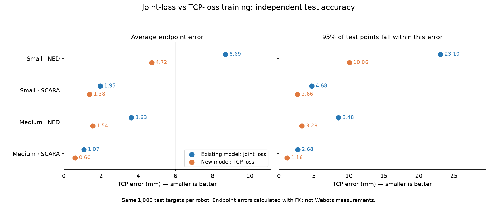

# Joint-loss versus TCP-loss MLP: small and medium datasets

The new TCP-loss model is compared with the existing saved NumPy MLP, using the same independent test targets. These results concern endpoint error calculated with forward kinematics, not newly measured Webots execution. The scikit-learn ANN baseline is a separate model and is not used here.

## Experiment

- Shared Ned/SCARA network: inputs `[is_scara, is_ned, x, y, z]`, two 64-unit ReLU hidden layers, three linear joint outputs.
- Seed 2026, Adam, batch 32, cosine learning rate 0.001 → 0.00001, maximum 3,000 epochs, patience 300.
- Per robot: small = 800 training + 200 validation; medium = 4,000 training + 1,000 validation. Both sizes use the same 1,000 independent test targets per robot.
- Joint baseline: MSE against normalised joint labels. TCP version: mean squared TCP distance in m² through each robot’s own FK, plus the fixed 0.01 joint-limit penalty. Neither robot’s FK is used for the other robot.
- Each model selects its checkpoint using its own validation objective. Test data does not enter training, epoch selection or weight tuning. Predictions are clipped to the same limits before endpoint evaluation, matching the controller.
- Both objectives were freshly trained at each size. Existing baseline weights were preserved and remain the primary comparison. The fresh joint-loss repeat is reported separately.

## Independent test results

All error values are millimetres. Smaller is better. P95 means 95% of test points had error at or below that value.

| Dataset | Robot | Existing joint mean | New TCP mean | Mean reduction | Joint P95 | TCP P95 |
|---|---|---:|---:|---:|---:|---:|
| Small | NED | 8.687 | 4.716 | 45.7% | 23.096 | 10.061 |
| Small | SCARA | 1.947 | 1.384 | 28.9% | 4.681 | 2.659 |
| Medium | NED | 3.625 | 1.544 | 57.4% | 8.477 | 3.281 |
| Medium | SCARA | 1.071 | 0.601 | 43.9% | 2.683 | 1.164 |



| Dataset | Robot | Joint maximum | TCP maximum | Joint within 5 mm | TCP within 5 mm |
|---|---|---:|---:|---:|---:|
| Small | NED | 92.985 | 49.638 | 40.2% | 67.2% |
| Small | SCARA | 72.517 | 8.682 | 96.4% | 99.7% |
| Medium | NED | 44.491 | 7.375 | 78.9% | 99.5% |
| Medium | SCARA | 6.550 | 2.175 | 99.9% | 100.0% |

The 5 mm threshold is an illustrative accuracy measure, not an asserted coursework pass criterion. Full median, RMSE, 10 mm success rate, clipping rate and joint metrics are in [summary.csv](summary.csv).

## Existing default large model (reference)

The controller defaults to the existing large joint-loss model. It was also evaluated on the same test points. This is an additional reference, not a matched-data-size experiment: large uses 12,000 training rows per robot, versus 4,000 for medium.

| Robot | Existing large joint mean | New medium TCP mean | Large joint P95 | Medium TCP P95 |
|---|---:|---:|---:|---:|
| NED | 2.738 | 1.544 | 6.515 | 3.281 |
| SCARA | 0.800 | 0.601 | 1.940 | 1.164 |

The medium TCP model also has lower observed mean and P95 endpoint errors than this larger existing baseline, in this fixed-seed experiment.

## Fresh joint-loss repeat

The original and repeated baselines have matching settings and input statistics but not identical weights. Small floating-point differences appear in the early loss histories and grow during optimisation. The repeat is included to show the result does not depend solely on the older checkpoint. This is not a multiple-seed experiment.

| Dataset | Robot | Original joint mean | Joint repeat mean | TCP mean |
|---|---|---:|---:|---:|
| Small | NED | 8.687 | 8.774 | 4.716 |
| Small | SCARA | 1.947 | 1.929 | 1.384 |
| Medium | NED | 3.625 | 3.703 | 1.544 |
| Medium | SCARA | 1.071 | 1.116 | 0.601 |

## Training completion

Both small and medium runs used the allowed 3,000-epoch budget with the existing early-stopping rule. Actual completed epochs and selected checkpoints:

| Dataset | Objective (fresh run) | Epochs completed | Selected epoch |
|---|---|---:|---:|
| Small | joints | 2562 | 2262 |
| Small | tcp | 1612 | 1312 |
| Medium | joints | 2931 | 2631 |
| Medium | tcp | 3000 | 2740 |

## Interpretation and limits

TCP error is the task measure; joint-label error scores agreement with one recorded pose. A TCP-trained solution may reach the target with different joints, so improved endpoint accuracy need not improve joint-label RMSE. Training losses have different units and should not be compared directly. For example, medium SCARA normalised joint RMSE increases from 0.0222 to 0.0511, while its mean endpoint error falls from 1.071 to 0.601 mm. Better agreement with a recorded joint pose and better positioning accuracy are distinct objectives.

These fixed-seed results are evidence for this dataset and architecture, not proof that TCP loss always wins. Multiple training seeds would be needed to estimate run-to-run variation. Errors on reachable test points do not establish behaviour outside the workspace. FK-based endpoint results should also be checked against measured TCP positions in Webots; joint-limit clipping alone does not prevent collisions.

## Files and reproduction

- `models/mlp_ned_scara_{small,medium}_h64x64_cosine_tcp.{npz,json}`: new TCP-trained checkpoints.
- Existing `..._cosine.{npz,json}` files: preserved joint-trained baseline checkpoints.
- [metrics.json](metrics.json): complete metrics, model configurations, and model/test SHA-256 hashes.
- [training_manifest.json](training_manifest.json): common settings and training/validation/test dataset hashes.
- Fresh repeat artifacts and training logs are retained locally under `outputs/tcp_loss_comparison/` (ignored by Git).

Reproduce the evaluation from the saved models:

```bash
python scripts/compare_mlp_losses.py --include-large-baseline
```

To train additional copies with the same settings, run the trainer for `--size small` and `--size medium`, once with `--loss joints` and once with `--loss tcp`. Those commands save under the usual model names, so preserve the supplied weights first if retaining this exact comparison. Results can vary with numerical libraries even at the same seed.
